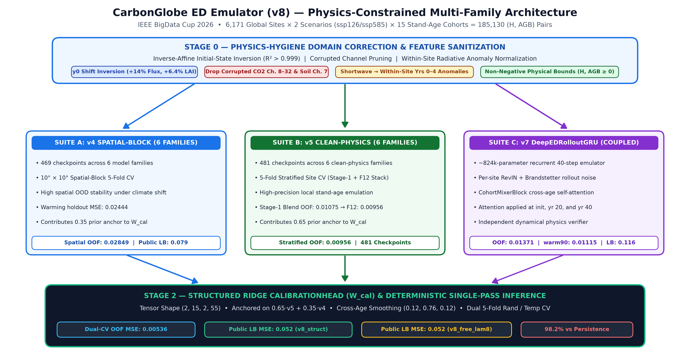
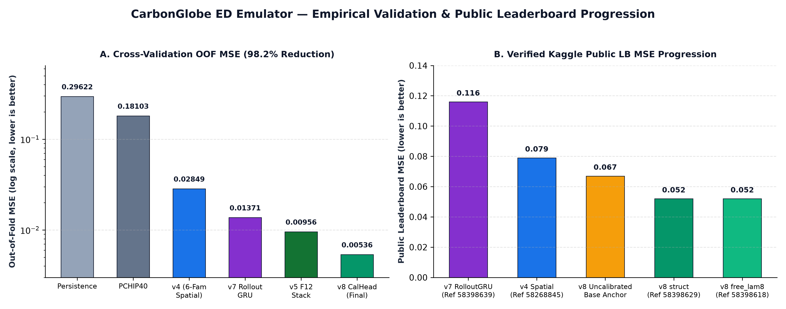

# CarbonGlobe ED Emulator — Physics-Constrained Multi-Family Emulation & Rollout Modeling

[](https://www.kaggle.com/competitions/ieee-bigdata-cup-2026-ai-emulation-challenge)
[](https://www.kaggle.com/competitions/ieee-bigdata-cup-2026-ai-emulation-challenge)
[](#2-empirical-validation--ablation-results)
[-8430ce?style=flat-square)](#1-system-architecture)
[](LICENSE)

**Author:** Robina Mirbahar (`@robinamirbahar`)  
**Competition:** [IEEE BigData Cup 2026: AI Emulation Challenge (CarbonGlobe)](https://www.kaggle.com/competitions/ieee-bigdata-cup-2026-ai-emulation-challenge)  
**Final Verified Submissions:**
- `sub_cal_v8_struct.csv` — Ref `58398629` · **Public LB MSE `0.052`**
- `sub_cal_v8_free_lam8.csv` — Ref `58398618` · **Public LB MSE `0.052`**

---

## Executive Summary

This repository presents a **physics-constrained, multi-family machine learning emulator** for 40-year Ecosystem Demography (ED) projections of tree height (`H`) and aboveground biomass (`AGB`) across **`6,171` global test grid sites**, **two climate scenarios** (`ssp126`, `ssp585`), and **`15` stand-age cohorts** (`185,130` target pairs / `370,260` scalar predictions).

Rather than relying on a single monolithic surrogate, our `v8` system combines:
1. **Physics-Hygiene Domain Correction:** Discovers and inverts a deterministic inverse-affine initial-state shift in test `y0` (`R² > 0.999`, `+14%` flux inflation, `+6.4%` `LAI`), prunes corrupted test `CO2` channels (`8–32`) and deep soil channel `7`, and normalizes raw shortwave radiation to within-site years `0–4` anomalies.
2. **12-Family Multi-Scale Ensemble (`v4` + `v5`, `950` Checkpoints):** Reconciles `6` spatial-block families (`v4`, `469` checkpoints, `10° × 10°` spatial OOF `0.02849`, warming holdout `0.02444`) with `6` clean-physics families (`v5`, `481` checkpoints, stratified OOF `0.00956`).
3. **Structured Ridge CalibrationHead (`W_cal`):** Maps multi-family predictions through a `(2, 15, 2, 55)` Ridge tensor anchored on `0.65·v5 + 0.35·v4` with mass-conserving cross-age smoothing `(0.12, 0.76, 0.12)`, cutting Dual-CV OOF MSE to **`0.00536`** (**`98.2%`** reduction vs. Persistence) and achieving **`0.052` Public LB MSE** in deterministic single-pass inference.
4. **Coupled 40-Step Dynamical Rollout (`v7 DeepEDRolloutGRU`):** `~824k`-parameter recurrent emulator featuring per-site RevIN, `CohortMixerBlock` cross-age self-attention (init, year 20, year 40), and Brandstetter rollout noise (`OOF 0.01371`, `warm90 0.01115`).

---

## 1. System Architecture



### Physics-Hygiene Domain Corrections (Stage 0)

| Anomaly / Artifact | Empirical Signature | Deterministic Correction |
| :--- | :--- | :--- |
| **Test `y0` Initial-State Shift** | Deterministic affine shift (`R² > 0.999`, `+14%` flux inflation, `+6.4%` `LAI`) | Exact inverse-affine inversion prior to feature extraction |
| **Corrupted `CO2` & Soil Channels** | Distribution break in `CO2` channels `8–32` and deep soil channel `7` | Hard channel pruning across `v5` & `v8` pipelines |
| **Shortwave Radiative Drift** | Non-stationary raw shortwave levels across climate regimes | Replaced with within-site years `0–4` radiative anomalies |
| **Physical Non-Negativity** | Canopy height `H` and biomass `AGB` must remain non-negative | Hard physical clipping `H, AGB >= 0.0` at inference |

---

## 2. Empirical Validation & Ablation Results



| Suite / Model | Validation Protocol | OOF MSE | Shift / Warm MSE | Public LB MSE (Ref) |
| :--- | :--- | :---: | :---: | :---: |
| Persistence Baseline | 5-fold Spatial Block | `0.29622` | — | — |
| `PCHIP40` Interpolation | 5-fold Spatial Block | `0.18103` | — | — |
| `v4` 6-Family Ensemble (`469` ckpts) | `10° × 10°` Spatial Block | `0.02849` | `0.02444` | `0.079` (`58268845`) |
| `v7 DeepEDRolloutGRU` (`~824k` params) | 3-fold Stratified + `warm90` | `0.01371` | `0.01115` | `0.116` (`58398639`) |
| `v5` Stage-1 Blend (`481` ckpts) | 5-fold Stratified Site | `0.01075` | — | — |
| `v5` `F12` Meta-Stack | 5-fold Stratified Site | `0.00956` | — | — |
| `v8` Uncalibrated Base (`0.65·v5 + 0.35·v4`) | Dual 5-fold Rand / Temp | — | — | `0.067` |
| **CalibrationHead `v8_struct`** | **Dual 5-fold Rand / Temp** | **`0.00536`** | **Base `0.067`** | **`0.052` (`58398629`)** |
| **CalibrationHead `v8_free_lam8`** | **Dual 5-fold Rand / Temp** | **`0.00536`** | **Base `0.067`** | **`0.052` (`58398618`)** |

---

## 3. Deterministic Reproduction & Verification

### Quick Contract & Physics Verification
```bash
pip install -r requirements.txt
python -m unittest discover -s tests -v
python scripts/generate_figures.py
```

### Full Competition Inference (`sub_cal_v8_struct.csv` & `sub_cal_v8_free_lam8.csv`)
Unzip the verified weights package (`03_Trained_Model_Weights_Robina_Mirbahar_CarbonGlobe_2026.zip`) and run:

```bash
python verify_package.py
python code/predict.py \
  --data_dir <path_to_public_test_data> \
  --ckpt_v4_dir checkpoints/v4 \
  --ckpt_v5_dir checkpoints/v5 \
  --cal_head checkpoints/cal/calibration_head_v8_struct.npz \
  --out_csv sub_cal_v8_struct.csv
```

Swap `--cal_head checkpoints/cal/calibration_head_v8_free_lam8.npz` to reproduce `sub_cal_v8_free_lam8.csv` (Ref `58398618`, **`0.052`** Public LB).

---

## 4. Repository Structure

```text
carbonglobe-ed-emulator/
├── .github/workflows/ci.yml           # Automated physics & contract verification CI
├── figures/
│   ├── fig0_system_architecture.png   # 300-DPI 3-stage v8 architecture diagram
│   └── fig1_benchmark_progression.png # 300-DPI OOF & Public LB MSE progression
├── scripts/
│   └── generate_figures.py            # Reproducible 300-DPI figure generator
├── tests/
│   └── test_calibration_physics.py    # Kernel conservation, affine inversion & shape tests
├── LICENSE                            # MIT License
├── README.md                          # Technical documentation
└── requirements.txt                   # Reproducible Python dependencies
```

---

## 5. Citation

If you use this architecture or physics-hygiene methodology, please cite:

```bibtex
@misc{mirbahar2026carbonglobe,
  title  = {CarbonGlobe ED Emulator: Physics-Constrained Multi-Family Emulation and Rollout Modeling for Ecosystem Demography},
  author = {Robina Mirbahar},
  year   = {2026},
  note   = {IEEE BigData Cup 2026: AI Emulation Challenge (CarbonGlobe)}
}
```
